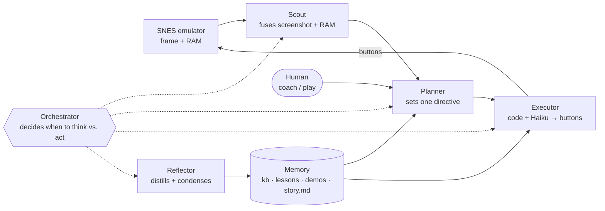

# retroarchAI

Load a SNES ROM and let an **LLM play it** — or hand the controller back to yourself at any time. A thin Python/`ctypes` libretro frontend drives a snes9x core; a team of Claude agents watches the screen + console RAM and presses the buttons, in a live pygame viewer you can watch, coach, and take over.

> Built for **turn-based / slower games** (RPGs, puzzles). The two it's been exercised on are **Ultima VII: The Black Gate** and **Final Fantasy III / VI (US)**.

## How it plays

An LLM takes ~0.5–5 s per decision; the SNES runs at 60 fps — so the AI does **not** play frame-by-frame. It observes, decides a short directive, and the cheap/code layer carries it out for a window of frames before re-consulting. The emulator keeps running between decisions (no frozen screen), and you can fast-forward through slow stretches.

Rather than one big prompt per frame, work is split across a **team of agents**, so the strong (expensive) model is called rarely and most ticks are near-zero-token code — roughly **7–12% of the tokens** a naive single-agent loop would burn.



- **Orchestrator** — the conductor (plain Python, zero tokens). Decides *when* to re-plan from cheap signals; routes everyone else.
- **Scout** — the senses. Reads the screenshot **and** the console RAM, reconciles them (memory wins), and is the only agent that transcribes on-screen text.
- **Planner** — the strategist (strong model, rare). Turns the Scout's report into one directive.
- **Executor** — the hands. Deterministic code primitives (`walk`/`goto`/`interact`) with a cheap LLM fallback.
- **Reflector** — the learner. Distills human demos/coaching into lessons and periodically condenses them.
- **Memory** — per-game `kb.json` (clues/mechanics), `lessons.json` (strategy), `demos.json` (raw human input), `story.md` (narrative/lore, consulted only for puzzles).

See [`docs/ARCHITECTURE.md`](docs/ARCHITECTURE.md), the running build log in [`docs/PROJECT_LOG.md`](docs/PROJECT_LOG.md), and future directions in [`docs/PROPOSALS.md`](docs/PROPOSALS.md).

## Requirements

- Linux (SDL/pygame), Python **3.12+** (developed on 3.14), a snes9x libretro core (`snes9x`/`snes9x2010`).
- **No API key needed** — gameplay shells out to the local `claude` CLI, powered by a **Claude Code subscription** (Pro/Max/Team/Enterprise). Models are chosen per role (`sonnet`/`haiku`/`opus`).
- A SNES ROM you legally own, plus an optional plain-text/markdown manual for controls.

## Quick start

```bash
python3 -m venv .venv && .venv/bin/pip install pygame-ce
```

Drop a game into its own folder and tell the launcher which one is active:

```
roms/<game>/
  your-rom.sfc            # the ROM (gitignored)
  game.json              # per-game config: rom, ram_reader, controls, goal, models
  <something>-controls.md # controls/manual the AI reads (text or markdown)
  knowledge/             # kb.json, lessons.json, demos.json, story.md (accrue as it plays)
  saves/                 # savestates + battery saves (gitignored)
```

`config/active.json` → `{"game": "<folder>"}` selects the game for a no-arg launch. Then:

```bash
.venv/bin/python tools/watch.py --start-mode ai
```

## Controls (the viewer)

| Key | Action |
|---|---|
| `TAB` | toggle this port between **AI** and **HUMAN** |
| `/` | **coach** the AI (type a hint; it steers the next decision and is saved as a lesson) |
| `F` | fast-forward (1× → 2× → 4× → 8× → 16×) |
| `M` | game sound on/off (muted during fast-forward) |
| `F1` / `C` | settings overlay / constants menu (both pause) |
| `F5` / `F9` | save / load a savestate |
| `SPACE` · `+` · `ESC` | pause · more rounds · quit |

Human play: arrows = D-pad, `Z`=B `X`=A `A`=Y `S`=X `Q`=L `W`=R, `Enter`=START, `RShift`=SELECT. While you play, the Scout keeps watching and learns from what you do.

## Status

Runnable and actively evolving. Everything game-specific lives under `roms/<game>/`; the per-game RAM reader (`src/emulator/memory_map.py`) turns console memory into ground-truth facts (position, HP/MP, battle state) that the agents read alongside the screen.

> Not affiliated with `MatPoliquin/RetroArchAI` (a RetroArch fork that drives input with trained PyTorch models per game). This borrows only the "switch a player to AI" UX idea — the architecture is entirely different. See [`docs/DECISIONS.md`](docs/DECISIONS.md).
